# Three.js Game Framework (Electron + React + Vite)

A game-focused desktop framework using:

- **Electron** for desktop packaging and native shell
- **React** for UI layers (HUD, menus, overlays)
- **Vite** for fast dev/build workflows
- **Three.js** as the rendering/game foundation

## Quick Start

```bash
npm install
npm run dev
```

## Scripts

- `npm run dev` — starts Vite and Electron together
- `npm run build` — builds the renderer app with Vite
- `npm run preview` — previews the Vite build
- `npm run electron` — runs Electron directly
- `npm run dist` — builds and packages desktop app via electron-builder

## Structure Diagram

```mermaid
flowchart TB

    subgraph CLIENT["Player Layer"]
        A["Desktop Browser"]
        B["Mobile Browser"]
        C["Gamepad / Keyboard Input"]
        D["Touch Controls"]
    end

    subgraph FRONTEND["Frontend - React + Vite"]
        E["React UI"]
        F["HUD System"]
        G["Inventory UI"]
        H["Settings Menu"]
        I["Authentication Pages"]
        J["State Management"]
    end

    subgraph GAMEENGINE["Three.js Game Engine"]
        K["Scene Manager"]
        L["Entity Component System"]
        M["Player Controller"]
        N["Physics Engine"]
        O["Animation System"]
        P["Audio Engine"]
        Q["Lighting System"]
        R["Particle Effects"]
        S["Raycasting System"]
        T["Camera Controller"]
    end

    subgraph WORLD["World Systems"]
        U["Chunk Loader"]
        V["Terrain Generator"]
        W["NPC AI System"]
        X["Quest System"]
        Y["Combat System"]
        Z["Loot System"]
        AA["Crafting System"]
        AB["Day Night Cycle"]
        AC["Weather System"]
    end

    subgraph NETWORK["Multiplayer Networking"]
        AD["Socket.IO Client"]
        AE["Realtime Sync"]
        AF["Matchmaking"]
        AG["Lobby System"]
        AH["Voice Chat"]
    end

    subgraph BACKEND["Backend API - Express.js"]
        AI["REST API"]
        AJ["Authentication Service"]
        AK["Game Session Service"]
        AL["Player Data Service"]
        AM["Inventory Service"]
        AN["Leaderboard Service"]
        AO["Chat Service"]
    end

    subgraph DATABASE["Database Layer"]
        AP[("PostgreSQL")]
        AQ["Redis Cache"]
        AR[("Cloud Storage")]
    end

    subgraph ASSETS["Asset Pipeline"]
        AS["GLTF Models"]
        AT["Textures"]
        AU["Audio Files"]
        AV["Shader System"]
        AW["Animation Files"]
    end

    subgraph DEVOPS["DevOps & Deployment"]
        AX["Docker"]
        AY["NGINX"]
        AZ["GitHub Actions"]
        BA["CDN"]
        BB["Monitoring"]
        BC["Cloud Hosting"]
    end

    A --> E
    B --> E
    C --> M
    D --> M

    E --> F
    E --> G
    E --> H
    E --> I
    E --> J

    J --> K

    K --> L
    L --> M
    L --> N
    L --> O
    L --> P
    L --> Q
    L --> R
    L --> S
    L --> T

    K --> U
    U --> V

    V --> W
    W --> X
    X --> Y
    Y --> Z
    Z --> AA

    V --> AB
    V --> AC

    K --> AD
    AD --> AE
    AE --> AF
    AF --> AG
    AG --> AH

    AD --> AI

    AI --> AJ
    AI --> AK
    AI --> AL
    AI --> AM
    AI --> AN
    AI --> AO

    AL --> AP
    AM --> AP
    AN --> AP

    AI --> AQ
    AI --> AR

    K --> AS
    K --> AT
    K --> AU
    K --> AV
    K --> AW

    AI --> AX
    AX --> AY
    AY --> BC

    AZ --> BC
    BC --> BA

    AI --> BB
    E --> BB
```


## Project Structure

```txt
.
New-World-Online-Framework
├─ electron
│  ├─ main.js
│  └─ preload.js
├─ index.html
├─ package-lock.json
├─ package.json
├─ PROJECT_DOCUMENTATION.md
├─ README.md
├─ src
│  ├─ App.jsx
│  ├─ components
│  │  ├─ GameCanvas.jsx
│  │  └─ InventoryPanel.jsx
│  ├─ data
│  │  ├─ gameData.js
│  │  ├─ items
│  │  │  ├─ consumables.json
│  │  │  ├─ keys.json
│  │  │  └─ tools.json
│  │  ├─ items.json
│  │  ├─ mapConfig.json
│  │  ├─ modelCatalog.json
│  │  ├─ objectLogic.json
│  │  ├─ scenes
│  │  │  ├─ crystal-gate.json
│  │  │  ├─ mystic-hills.json
│  │  │  ├─ scenes.json
│  │  │  └─ starter-valley.json
│  │  └─ worldData.json
│  ├─ game
│  │  ├─ camera.js
│  │  └─ inventory.js
│  ├─ logic
│  │  └─ devPanelLogic.js
│  ├─ main.jsx
│  ├─ models
│  │  └─ devPanelModel.js
│  ├─ scenes
│  │  └─ sceneLoader.js
│  └─ styles.css
└─ vite.config.js
```

## Notes

- Security defaults are enabled (`contextIsolation: true`, `nodeIntegration: false`, `sandbox: true`).
- Start building gameplay in `src/components/GameCanvas.jsx`.
